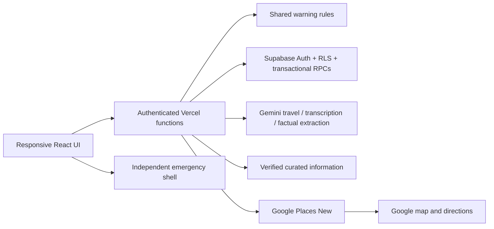

# Architecture and invariants

## Trust boundaries

Browser configuration contains only publishable Supabase configuration and the browser-restricted Maps key. AI, Places server and administration keys remain server-only. Supabase requests use the caller's JWT, not an administrative bypass. Every privileged RPC derives identity from `auth.uid()` and has a fixed search path and restricted execute grants.

User text, transcripts, model output and old messages are untrusted. Zod constrains events and actions. Model timestamps are discarded; code resolves supported durations only. UI actions are fixed types, never executable URLs or arbitrary tool names. Rendered message contents remain plain text. Provider directions URLs are constructed by the server, constrained to Google; attribution URLs require HTTPS.

## Storage

Nine core tables: `profiles`, `health_profiles`, `emergency_contacts`, `journeys`, `journey_events`, `conversations`, `messages`, `medical_knowledge`, `consent_records`. Operational tables: `request_records`, `usage_counters`.

Composite foreign keys couple journey/conversation/message identity to user identity. A partial unique index allows one active journey per user; activation completes the previous one transactionally. Turn saving inserts user message, saved events, assistant result and request record in one transaction. Failed insertion rolls back the complete turn. Advisory locks serialize matching request IDs and shared quota counters.

Request IDs deduplicate retries; concurrent first-time calls can still consume extra provider quota before persistence. Event deletion invalidates cached request acknowledgements for that user. Historical conversation text can still describe a removed event; this is explicitly explained in deletion UI. Reusing a very old request ID after deliberately deleting its records is outside retry guarantees.

## Health and time

Client and server use the same warning rules and source reply module. Emergency visibility does not wait for network success. The rules are informational and **not clinically validated**. Unsupported health topics receive no invented source or diagnosis. A configured optional model call may extract reported facts from a mixed health/logging turn; its schema has no health response field. Urgent turns bypass that call.

Model travel replies containing health language are replaced with curated replies. This is an additional conservative filter, not a guarantee of perfect language classification. Health-profile fields are excluded from AI input. Recent-context queries remain user-scoped and use occurrence time; undated records use creation time explicitly as a fallback. Older episodes are bounded records, not inferred clinical relationships.

## Privacy and availability

Consent to storage and external processing are independent. Revocation blocks new saving/processing without silently deleting old data. Deletion remains available without active storage consent. Own-account deletion requires server administration configuration and cascades records through auth-user foreign keys.

The service worker ignores authenticated requests, `/api/` and third-party origins. Only static assets enter the app-shell cache. Its release identifier derives from built HTML. Private record caches live in TanStack Query memory and clear on sign-out; conversation state also resets across account identity changes. Voice cancellation releases microphone tracks, audio context and pending local audio buffers.

Missing configuration yields explicit setup/unavailable errors. Provider calls have timeouts; clients have a 45-second limit. Retry is explicit and uses the original turn identifier. Cloud integration is unverified until the configured end-to-end scenario passes.
